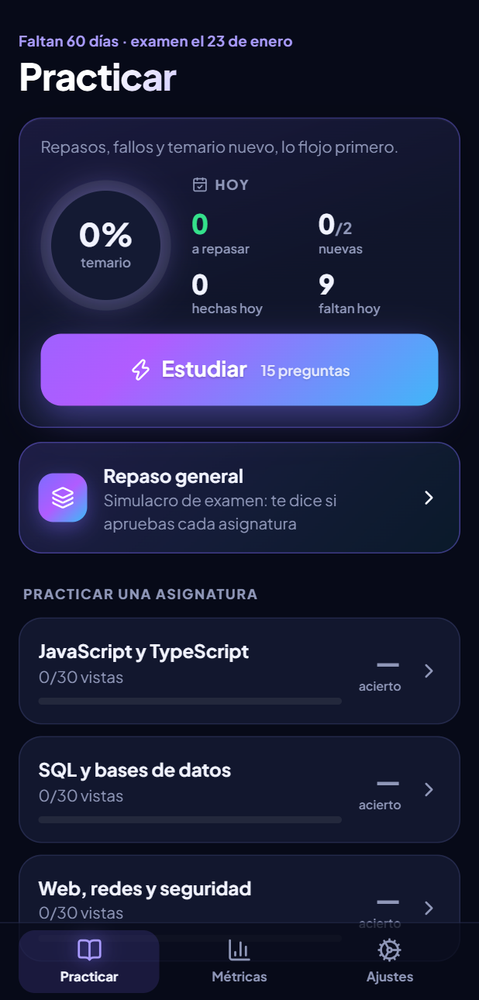
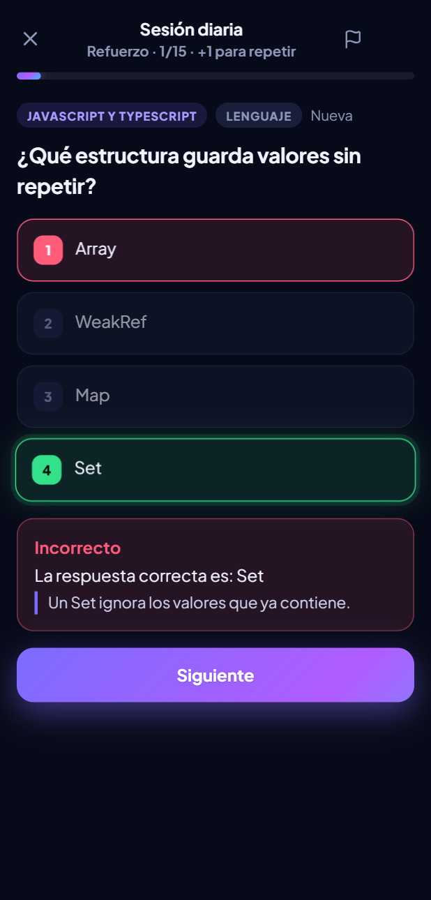

# Repaso Espaciado

Installable web app (PWA) to prepare multiple-choice exams with spaced repetition.

**Demo:** https://serberar.github.io/repaso-espaciado/ (no account: progress stays in your browser)

<p>
  
  
</p>

- One button decides what to ask: due reviews, mistakes and new questions, weakest topics first.
- A daily plan up to the exam date, and an estimated grade per subject.
- Works offline: pending answers are uploaded when the connection is back.
- Add your own subjects with a JSON file.
- Optional Supabase accounts, with one row per answer so several devices never overwrite each other.

```bash
npm install
npm run dev
npm run lint && npm test
```

React, TypeScript, Vite and Supabase (Auth and Postgres with RLS). More details in the [Spanish README](README.md). [MIT](LICENSE) license.
